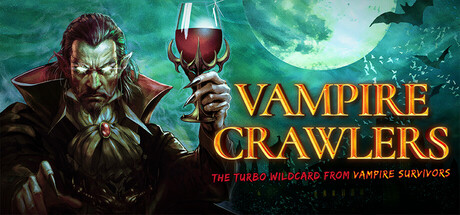

[简体中文](README.md) | English

# Vampire Crawlers Wiki

**[Try it online](https://icodyyang.github.io/Vampire-Crawlers-Wiki/)** · [Download the offline edition](https://github.com/iCodyYang/Vampire-Crawlers-Wiki/releases/latest)

Open the online guide without downloading anything. Internet access is needed to load the website; download the HTML file for offline use.

**An offline card encyclopedia and evolution guide.**

Created and maintained by **ZhetengFM (折腾FM)**. Look up card effects, evolution recipes, gem combinations, and unlock requirements for *Vampire Crawlers*. Supports desktop and mobile layouts, with Chinese and English language options.

## Getting started

1. Download [吸血鬼爬行者Wiki.html](吸血鬼爬行者Wiki.html) using GitHub's **Download raw file** button.
2. Open the downloaded file in your browser. No installation, account, or server setup is needed.

**This repository provides the single-file HTML web edition.** Images and reference data are embedded in the file, so the guide works offline. It does not update automatically or read game saves. Links to external reference sites and podcast platforms require an internet connection.

The same HTML file adapts to smaller screens: a bottom navigation bar provides access to Home, Evolutions, Encyclopedia, Unlocks, and More. Compact recipe layouts make browsing easier on phones. Narrowing a desktop window also activates this layout.

A Xiaohongshu mini-tool edition is also available through [ZhetengFM's Xiaohongshu profile](https://xhslink.cn/o/5JNfppjlgps). This is a separate way to use the guide; you do not need to download or run that edition to use this repository.

## Features

| Feature | What you can do |
| --- | --- |
| Evolution recipes | Browse 17 illustrated recipes, mark the materials you have, and check what is missing. |
| Encyclopedia | Search and filter 108 cards, 58 gems, and 115 entries covering game systems, including 18 relics. |
| Unlock guide | Check requirements and rewards for 28 goals, including an 18-relic checklist, and track your progress. |
| Builds and FAQ | Explore build ideas and learn about mana-cost combos, evolutions, gems, and other mechanics. |
| Favorites and progress | Bookmark entries, save material selections and unlock progress, and create manual backups. |
| Chinese and English | Switch languages for the interface, entries, and guides. English wording is an assisted translation. |

On desktop, hover over an icon for a preview and click for details. On mobile, tap it. Favorites and progress are stored in the current browser; back them up before switching devices or clearing browser data.

*Official game promotional artwork, not a screenshot of this tool.*

## Version and data

- **Tool version: 1.3.0.**
- **Relic update:** Includes all 18 listed relics and matching unlock entries. Names, effects and acquisition dungeons for Galileo’s Hand and Tappo were verified against game resources on 2026-10-13. Other content remains based on 1.5; this is not a complete 1.6.1 dataset.
- **Data baseline: version 1.5 of the Steam Chinese encyclopedia (June 23, 2026)**; references reviewed on October 13, 2026.
- This is an offline snapshot. Updates are distributed as new HTML files, rather than synchronized with game updates.

The tool version and the reference-data version are separate. Death Parade additions are not yet fully covered, and the unlock guide is not a complete achievement list. Where information differs, refer to the version of the game you are playing.

## About ZhetengFM

This project is created and maintained by **ZhetengFM (折腾FM)**.

ZhetengFM is an interview podcast about people who love to tinker. We seek out people who have spent years pursuing something, experimenting, and gradually finding their own way. We talk about how they started, how they explore their interests, and how those passions and experiences shape their lives.

**There is romance in taking play seriously.**

### Listen and follow

[Xiaoyuzhou](https://www.xiaoyuzhoufm.com/podcast/6aa75d71f6a83c7aadb07de1) · [Ximalaya](https://xima.tv/1_EPMW7h?_sonic=0) · [Apple Podcasts](https://podcasts.apple.com/cn/podcast/%E6%8A%98%E8%85%BEfm/id6811446094)

[Xiaohongshu](https://xhslink.cn/o/5JNfppjlgps) · [Bilibili](https://space.bilibili.com/210202907) · [QQ Music](https://c6.y.qq.com/base/fcgi-bin/u?__=FxuIw77Oqkhg)

[Lizhi](http://m.lizhi.fm/vod/voicesheet/5521195757702708289?u=2612439153109150252) · [NetEase Cloud Music](https://163cn.tv/biuIL9Iy) · [Spotify](https://open.spotify.com/show/0V1IDpZKL0fSyQea493QSx?si=b1b9e510b0ca4764)

Search for **折腾FM** to find the show. You can also subscribe through podcast apps that support RSS.

### Contact

- **Bilibili / Xiaohongshu:** [折腾FM on Bilibili](https://space.bilibili.com/210202907) / [折腾FM on Xiaohongshu](https://xhslink.cn/o/5JNfppjlgps)
- **Email:** [zheteng@agent.qq.com](mailto:zheteng@agent.qq.com)

Guest suggestions, show feedback, and business inquiries are welcome. To report a Wiki error, please include the entry name, game version, and a supporting reference.

## Sources and permissions

- Chinese reference data: [丸比 and 静火's Vampire Crawlers Encyclopedia](https://steamcommunity.com/sharedfiles/filedetails/?id=3716466231). Adapted reference data retains attribution and the original [CC BY-NC-SA 4.0](https://creativecommons.org/licenses/by-nc-sa/4.0/) license.
- Entry and image references: [Vampire Crawlers Wiki](https://vampire.survivors.wiki/w/Crawlers:Wiki). Individual sources are listed inside the tool.
- Game artwork, characters, music, sound effects, and trademarks belong to poncle, Nosebleed Interactive, and their respective rights holders. The project icon is a derivative made from official artwork.

This is a non-profit fan project for personal learning and use, with no affiliation, sponsorship, or authorization from the game's rights holders.

**Source-available for non-commercial use; not released under a standard open-source license.** See [LICENSE.md](LICENSE.md). Third-party materials retain their own terms; publishing this repository does not grant rights to the game assets.
